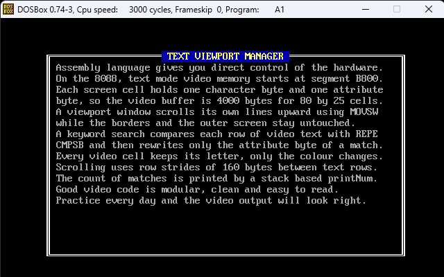
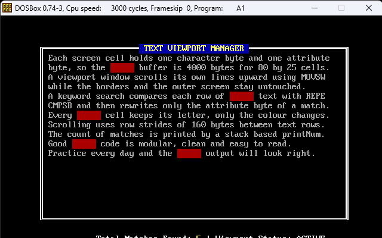

# COAL - Assembly Language Programs

**Name:** Fajar Zahid
**Roll No:** 25l-0638

## Description
Assignment 3: Text Viewport Manager with Windowed Scrolling and Live Keyword
Highlighter. A 16-bit 8088 program that draws a bordered window, streams text
into it, scrolls only the window contents, highlights a keyword in video memory
and shows the match count on a status bar.

## Tools Used
- NASM (assembler)
- DOSBox (emulator)

## How to Assemble and Run
```
nasm q2.asm -f bin -o q2.com
dosbox
mount c C:\path\to\Assignment3
c:
q2.com
```

## Folder Structure
```
COAL/
├── Assignment3/
│   ├── q2.asm
│   ├── output1.png
│   └── output2.png
└── README.md
```

## Output Screenshots


